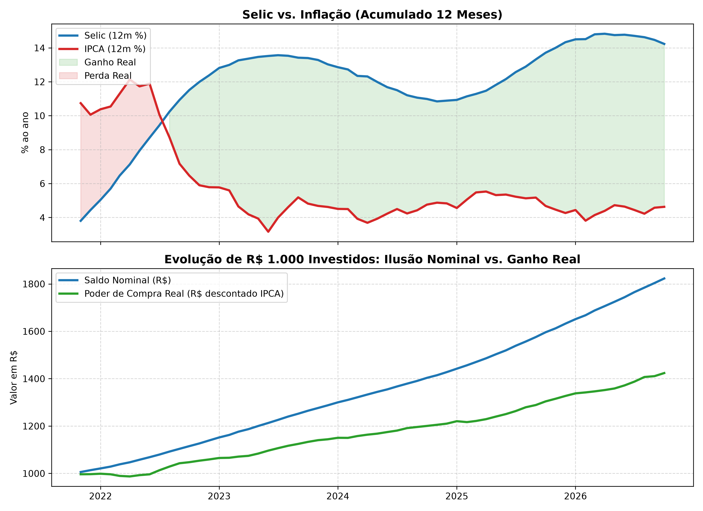

# Análise de Juro Real no Brasil: Selic vs. Inflação (2021–2026)

## 📌 Problema de Negócio
Quem deixou recursos aplicados rendendo 100% da taxa Selic nos últimos 5 anos realmente ganhou poder de compra acima da inflação (IPCA), ou houve ilusão monetária? Este projeto coleta dados oficiais diretamente da API do Banco Central do Brasil para medir o retorno real ao investidor.

## 🛠️ Ferramentas e Metodologia
* **Linguagem:** Python (`pandas`, `matplotlib`)
* **Fonte de dados:** Sistema Gerenciador de Séries Temporais (SGS) do Banco Central do Brasil (Séries `4390` - Selic mensal e `433` - IPCA mensal).
* **Cálculos:** Acumulado móvel em 12 meses, deflacionamento pela Equação de Fisher e simulação de capital acumulado (nominal vs. real).

* ## 📊 Principais Resultados (11/2021 a 10/2026)
* **Selic acumulada (últimos 12 meses):** `14,23%`
* **IPCA acumulado (últimos 12 meses):** `4,63%`
* **Juro real ex-post (últimos 12 meses):** `9,18%` ao ano
* **Simulação de R$ 1.000,00 investidos em 11/2021:**
  * **Saldo nominal:** R$ 1.823,07 (+82,3%)
  * **Poder de compra real (descontado o IPCA):** R$ 1.423,74 (+42,4% de ganho real líquido)

## 📈 Visualização

## 💡 Conclusão a partir dos resultados
Apesar do forte impacto inflacionário no início do período analisado (entre final de 2021 e meados de 2022, quando o poder de compra ficou praticamente estagnado), a manutenção da Selic em patamar elevado garantiu um ganho real expressivo de **42,4% acima da inflação** no horizonte de 5 anos, evidenciando o peso do juro real brasileiro na renda fixa.
